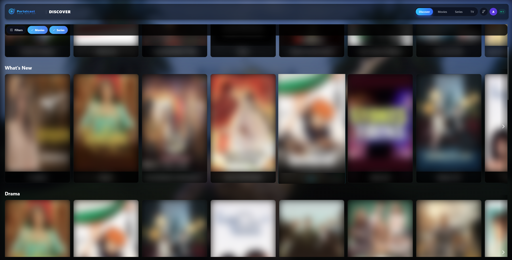
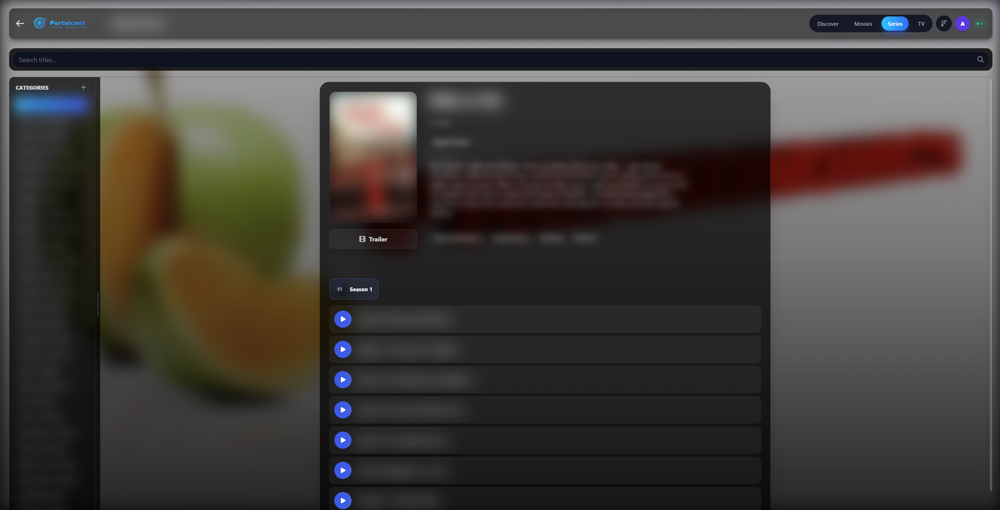
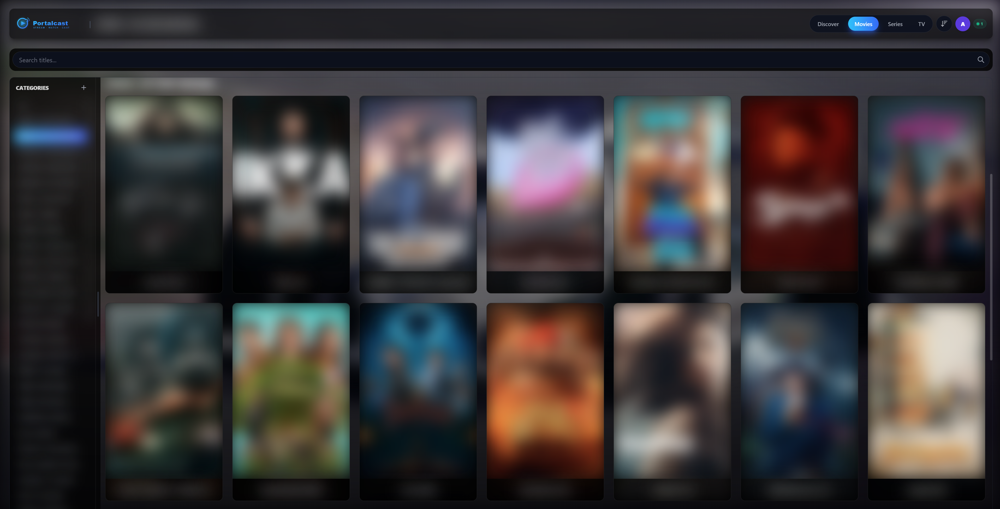
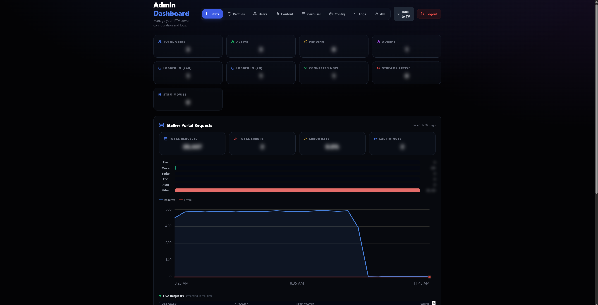

<p align="center">
  <picture>
    <source media="(prefers-color-scheme: dark)" srcset="brand/svg/portalcast-logo.svg">
    
  </picture>
</p>

<p align="center"><b>PortalCast Web</b> is the browser app for PortalCast: Discover, movies, series and live TV, on desktop, phone and Smart TV browsers.</p>

<p align="center">
  
  
  
  
</p>

<p align="center">
  <a href="https://github.com/dhrumilshukla258/portalcast-server">Server</a> ·
  <b>Web app</b> ·
  <a href="https://github.com/dhrumilshukla258/portalcast-tv-android">Android TV app</a>
</p>

---

<table>
  <tr>
    <td width="50%"><p align="center"><sub>Discover</sub></p></td>
    <td width="50%"><p align="center"><sub>Series</sub></p></td>
  </tr>
  <tr>
    <td width="50%"><p align="center"><sub>Movies</sub></p></td>
    <td width="50%"><p align="center"><sub>Admin</sub></p></td>
  </tr>
</table>

<sub>Artwork and titles are blurred in the screenshots.</sub>

## Features

- **Search** across every movie, series and live channel at once; versions of a title are one result.
- **Discover** with a rotating backdrop, recommendations, and Genre / Language / Country / Channel / Mood selectors; channel and platform badges on cards.
- **Series** with TMDB episode stills and descriptions, air dates, and the page opening on the episode you are watching.
- **Player** with live TV and EPG, subtitles (online search, embedded tracks, your own file) with per-title timing, real resolution and frame rate, next-episode prompt.
- **Continue Watching** synced with the TV app; favourites and recent channels sync live across devices.
- **Admin** — users, profiles, content manager, broken streams, security log, live viewers and server logs.
- Runs in any modern browser and Samsung/LG TV browsers; installable as a PWA.

## Get started

This app needs a running [PortalCast Server](https://github.com/dhrumilshukla258/portalcast-server); the server ships with a recent build of it in `public/`, so most people never build this repo.

To develop or ship your own build:

```bash
npm install
cp .env.example .env    # set VITE_API_HOST only if the server is on another origin
npm run dev             # http://localhost:5173
npm run build           # builds dist/ and copies it to ../portalcast-server/public
```

Set `PORTALCAST_SERVER_PUBLIC_DIR` to copy somewhere else. `./deploy.sh --tizen` builds for a Samsung Tizen app instead (fixed server address from `.env`).

## Docs

- `docs/skill-*.md` — one page per area (Discover, browsing, video playback, API client, auth, admin, TV-remote navigation, build and deploy)
- [brand/](brand/README.md) — the PortalCast logo kit used by every client

## Disclaimer

PortalCast is software only. It does not provide, host or distribute any content; you connect it to a provider you are entitled to use.

## License

MIT — see [LICENSE](LICENSE).
