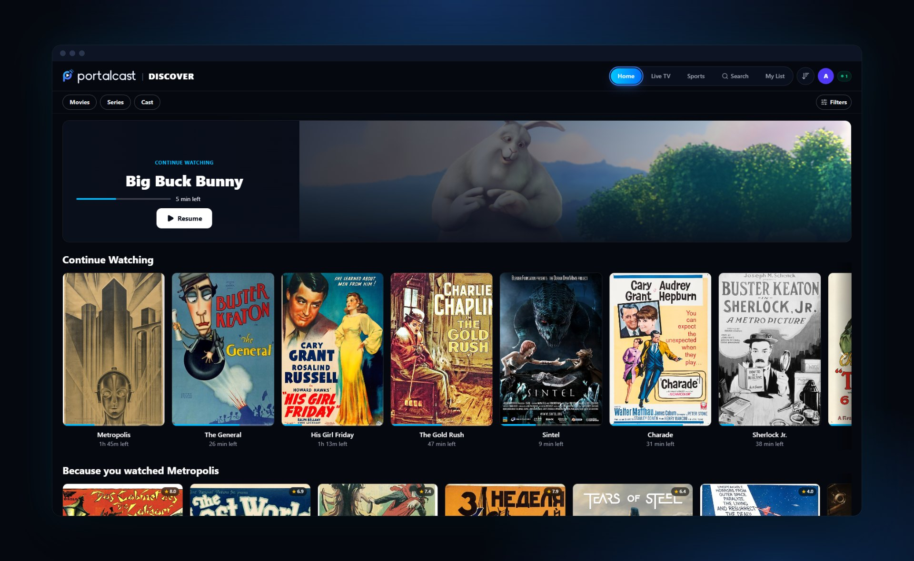
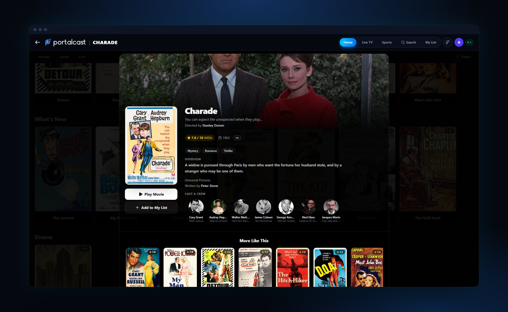
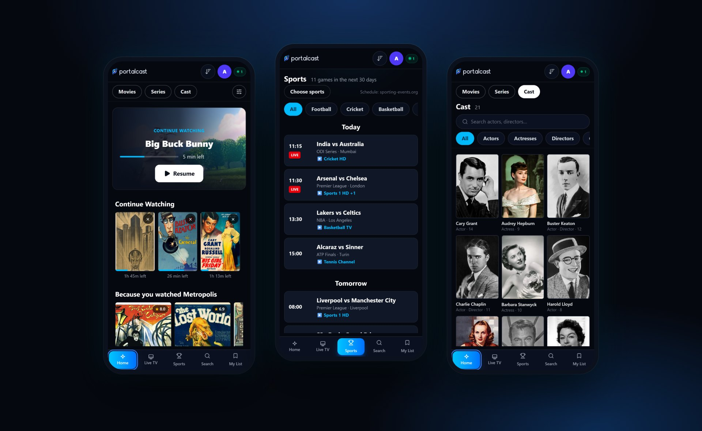

<p align="center">
  <picture>
    <source media="(prefers-color-scheme: dark)" srcset="brand/svg/portalcast-logo.svg">
    
  </picture>
</p>

<p align="center"><b>PortalCast Web</b> is the browser app for PortalCast: Discover, movies, series and live TV, on desktop, phone and Smart TV browsers.</p>

<p align="center">
  
  
  
  
</p>

<p align="center">
  <a href="https://github.com/dhrumilshukla258/portalcast-server">Server</a> ·
  <b>Web app</b> ·
  <a href="https://github.com/dhrumilshukla258/portalcast-tv-android">Android TV app</a>
</p>

---

<p align="center"></p>
<p align="center"></p>
<p align="center"></p>

<p align="center"><sub>Demo data. Artwork: public-domain film posters and stills, and the Blender Foundation's open movies (CC BY), via Wikimedia Commons.</sub></p>

## Features

- **The same app everywhere** — five tabs (Home, Live TV, Sports, Search, My List) and Movies · Series · Cast chips on PC, phone and TV browsers, in one black-blue page from edge to edge.
- **Home made for each viewer** — your last title to resume up top, Continue Watching, "Because you watched", top picks and trending, built from what this profile watched. One card per title across all its language and quality versions. It opens on the Home you saw last, at once.
- **Filters** — genre, language, country, channel or platform and mood, plus the provider's own **IPTV categories** and **My library** (your own files) as separate choices.
- **Title menu** — hold a card (right-click or ⋯ on PC) to add it to My List, mark it watched, say "Not interested" (it leaves every Home row) or remove it from Continue Watching. **My List** keeps My List, Watched, Not interested and favourite channels, so anything can be undone.
- **Title pages** — backdrop, tagline, ratings, cast and crew with photos, and More Like This. Series open on the episode you are watching, with TMDB episode stills and air dates.
- **Cast** — actors, actresses, directors, creators and writers with photos, ranked by what the profile watches; a person's page lists every title of theirs you have.
- **Sports** — the next 30 days of the sports and leagues each viewer chooses (football, cricket, NBA, F1, tennis…), with the channel showing each match from your provider's TV guide.
- **Live TV** with the guide, catch-up, favourites and recent channels synced live across devices.
- **Search** across every movie, series, channel and person at once.
- **Player** — subtitles (online search, embedded tracks, your own file) with per-title timing, real resolution and frame rate, next-episode prompt.
- **Admin** — users, profiles, settings, content manager, broken streams, security log, live viewers and server logs.
- Runs in any modern browser and Samsung/LG TV browsers; installable as a PWA.

## Get started

This app needs a running [PortalCast Server](https://github.com/dhrumilshukla258/portalcast-server); the server ships with a recent build of it in `public/`, so most people never build this repo.

To develop or ship your own build:

```bash
npm install
cp .env.example .env    # set VITE_API_HOST only if the server is on another origin
npm run dev             # http://localhost:5173
npm run build           # builds dist/ and copies it to ../portalcast-server/public
```

Set `PORTALCAST_SERVER_PUBLIC_DIR` to copy somewhere else. `./deploy.sh --tizen` builds for a Samsung Tizen app instead (fixed server address from `.env`).

## Docs

- `docs/skill-*.md` — one page per area (Discover, browsing, video playback, API client, auth, admin, TV-remote navigation, build and deploy)
- [brand/](brand/README.md) — the PortalCast logo kit used by every client

## Disclaimer

PortalCast is software only. It does not provide, host or distribute any content; you connect it to a provider you are entitled to use.

## License

MIT — see [LICENSE](LICENSE).
